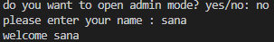
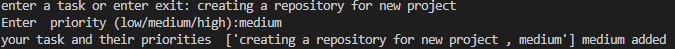
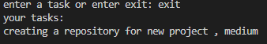
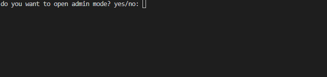

# Personal Task Mananger 

### A simple personal task manager built with 
## Table of contents
- [Features](#features)  
- [Project Structure](#project-structure)  
- [Requirements](#requirements)
- [Installation](#installation)
- [Environment Setup](#environment-setup)
- [Usage](#usage)
- [Roadmap](#roadmap)
- [Screen shot](#screen-shot)
- [Contributing](#contributing)
- [License](#license)
- [Author](#author)

## Features
- Task Manager System
    - Get username from the user
    - Add multiple tasks 
    - Display all saved tasks
    
- Result storage
    - Saves tasks result in `tasks.txt`

- Includes an admin mode 
    - Asks for the admin password 
    - Checks if the password is correct
    - Keeps the private information outside the main python file
    - loads the password from `.env`


## Project Structure
``` text


│   .env.example
│   .gitignore
│   main.py
│   README.md
│   requirements.txt
│   task.py
│
├───gifs
│       task_demo.gif
│
├───pictures
│       pic1.png
│       pic2.png
│       pic3.png
│
└───
```
### File Description 
| File | Description | 
| --- | --- | 
| ` main.py ` | main file used to run quiz game |
| `  task.py ` | stores questions and answers |
| `requirements.txt` | lists the python packages needed for the project. |
| `.env.example ` | shows the environment variables needed by the project |
| `.gitignore ` | tells git which files and folders should not be tracked |
| `.README.md ` | contains the project documentation |
| `pictures/ ` | stores project screenshots |   
| `pictures/pic1.png ` | screenshot of the  start program |
| `pictures/pic2.png ` | screenshot of the task section |
| `pictures/pic3.png ` | screenshot of the final result |
| `gifs/ ` | stores demo GIF files |
| `gifs/quiz_demo.gif ` | shows the project demo |

## Requirements
before running the project, make sure you have:
- `python 3`
- `python-dotenv`

## Installation
1. Open a terminal in the project folder.
2. check that python is installed :
```bash
python--version
```
3. Install the python packages:
```bash
pip install -r requirements.txt

```

## Environment Setup
1. create a `.env` file from `.env.example`:
```bash
cp .env.example .env
```
2. Open the new `.env` file
3. Replace the example value  with your own password
```text
TASK_MANAGER_ADMIN_PASSWORD= your_password_here
```
4. save the file.

> do not commit your `.env` file becuase it may contain private information


## Usage
1.  Open a terminal in the project folder
2. Run the task manager
```bash
python main.py
```
3. Choose `yes` or `no` for admin mode
4. If you choose `yes` enter a password from your `.env` file
5. Enter your name
6. Enter a task
7. See all your saved tasks
8. Enter another task or exit
8. Your result is saved in `tasks.txt`


## Example Output
```text
do you want to open admin mode? yes/no: no
please enter your name : sana
welcome sana
enter a task or enter exit: creating a repository for new project
Enter  priority (low/medium/high):medium
your task and their priorities  ['creating a repository for new project , medium'] medium added
enter a task or enter exit: exit
your tasks: 
creating a repository for new project , medium
```

## Screen shot
### Start program


### Task



### End of the program



## Demo



## Roadmap
- [x] add multiple tasks
- [x] show all tasks
- [x] admin mode
- [x] save tasks to a file
- [ ] remove completed tasks
- [ ] add due dates
- [ ] categorize tasks
- [ ] search tasks
- [ ] filter tasks
- [ ] add reminders
## Contributing

## License

## Author
create by [sana](https://github.com/sanajanmohamadi)